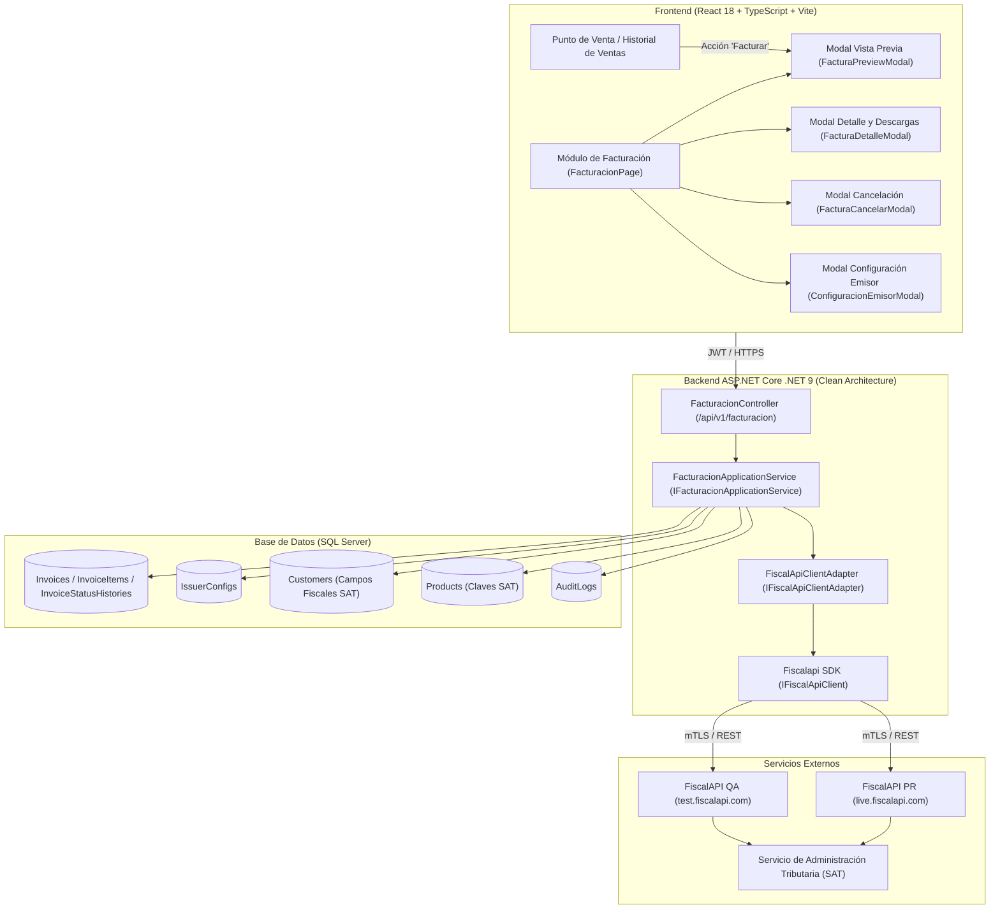
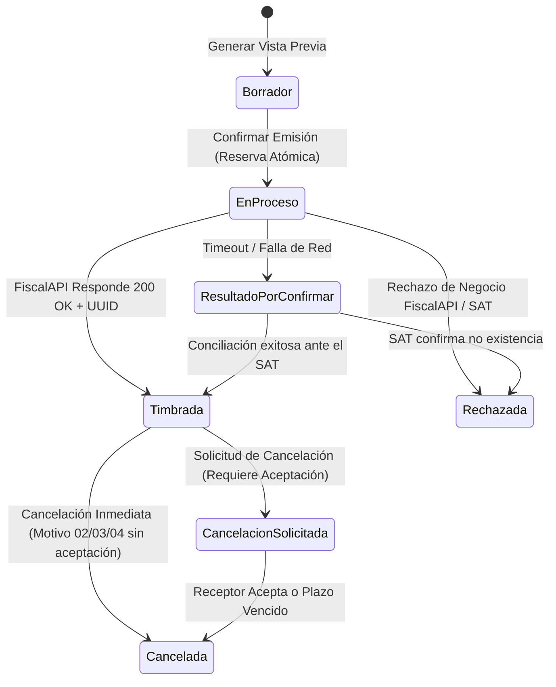
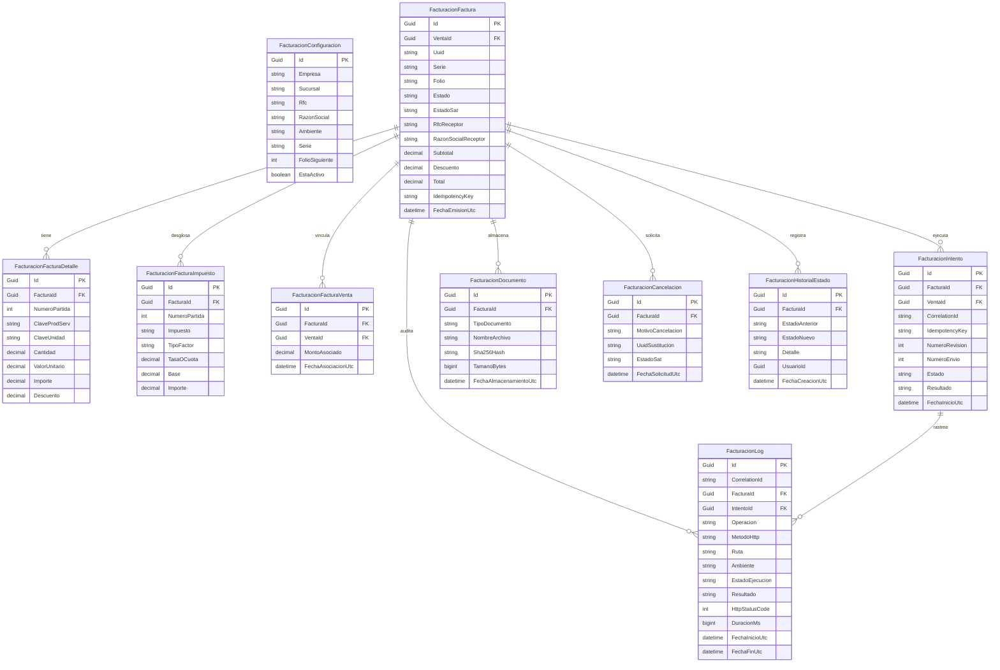

# Módulo de Facturación Electrónica CFDI 4.0 con FiscalAPI .NET SDK

## 1. Resumen Ejecutivo y Arquitectura

El módulo de Facturación Electrónica para **PDV Lambrín / WPC Bajío** implementa la emisión, vista previa, consulta, cancelación y descarga de Comprobantes Fiscales Digitales por Internet (CFDI 4.0) de tipo Ingreso (`I`), integrando el SDK oficial de **FiscalAPI para .NET** (`Fiscalapi` NuGet v4.0.469).

### 1.1 Diagrama de Arquitectura



### 1.2 Capas y Responsabilidades

1. **`Pos.Domain`**:
   - Entidades: `ConfiguracionEmisor`, `Factura`, `FacturaPartida`, `FacturaHistorialEstado`.
   - Extensiones de entidades: `Cliente` (RFC, razón social, régimen, CP fiscal, uso CFDI, email facturación) y `Producto` (clave SAT, clave de unidad, objeto de impuesto).
   - Constantes: `FacturacionConstants.cs` con catálogos oficiales del SAT v4.0 (Regímenes, Usos CFDI, Formas de Pago, Métodos de Pago, Motivos de Cancelación).
2. **`Pos.Application`**:
   - Interfaz de servicio: `IFacturacionApplicationService`.
   - DTOs de solicitud y respuesta: `VistaPreviaFacturaDto`, `SolicitarEmisionFacturaDto`, `ResultadoEmisionFacturaDto`, `ConfiguracionEmisorDto`, `CancelarFacturaDto`, etc.
   - Códigos de permisos en `PermissionCodes.Invoicing` (`View`, `Issue`, `Cancel`, `Configure`).
3. **`Pos.Infrastructure`**:
   - Adaptador desacoplado `IFiscalApiClientAdapter` y su implementación `FiscalApiClientAdapter` consumiendo `IFiscalApiClient`.
   - Opciones tipadas `FacturacionSettings` con validación estricta de arranque entre ambiente (`QA` / `PR`) y URL oficial (`test.fiscalapi.com` / `live.fiscalapi.com`).
   - Mapeos de persistencia EF Core 9 y migración versionada `20261108041333_AddFacturacionModule`.
4. **`Pos.Api`**:
   - Controlador REST `FacturacionController` con rutas estándar `/api/v1/facturacion` y `/api/v1/invoicing`.
   - Políticas de seguridad y autorización por permisos granulares.
5. **`pos-web` (Frontend)**:
   - Vistas completas con soporte bilingüe (Español y Chino Simplificado `zh-CN`).
   - Gestión integral de estados locales, estados SAT, descargas y cancelación.

---

## 2. Configuración de Ambientes (QA vs PR)

FiscalAPI opera con dos ambientes completamente independientes:

| Entorno | URL Oficial | Propósito |
| :--- | :--- | :--- |
| **QA (Pruebas)** | `https://test.fiscalapi.com` | Emisión con certificados de prueba del SAT y cuentas sandbox. |
| **PR (Producción)** | `https://live.fiscalapi.com` | Emisión fiscal legal y timbrado directo ante el SAT. |

### 2.1 Validación Estricta de Arranque

La clase `FacturacionSettings.ValidateWithFiscalapi(...)` se ejecuta al iniciar la aplicación (`Program.cs` / `DependencyInjection.cs`). Si detecta una discordancia entre el ambiente y la URL configurada, aborta inmediatamente el inicio para evitar timbrar facturas de producción en QA o enviar pruebas a producción:

- Si `Ambiente == "QA"` y la URL **no** contiene `test.fiscalapi.com`, lanza `InvalidOperationException`.
- Si `Ambiente == "PR"` y la URL **no** contiene `live.fiscalapi.com`, lanza `InvalidOperationException`.
- Si `Habilitada == false`, el sistema arranca normalmente pero desactiva la emisión sin afectar el resto de operaciones del PDV (degradación elegante).

### 2.2 Inyección Segura de Variables de Entorno

**Nunca** deben guardarse llaves privadas, API keys ni secretos en archivos de configuración versionados (`appsettings.json`, repositorios Git) ni exponerse al frontend (prohibido usar variables `VITE_*` para secretos).

En el servidor VPS (`/etc/systemd/system/pos-api.service` o archivo de entorno seguro):

```bash
# Entorno QA (Pruebas)
FiscalapiSettings__ApiUrl="https://test.fiscalapi.com"
FiscalapiSettings__ApiKey="TU_API_KEY_DE_QA"
FiscalapiSettings__Tenant="TU_TENANT_ID_DE_QA"
Facturacion__Ambiente="QA"
Facturacion__Habilitada="true"
Facturacion__TimeZone="America/Mexico_City"

# Entorno PR (Producción)
FiscalapiSettings__ApiUrl="https://live.fiscalapi.com"
FiscalapiSettings__ApiKey="TU_API_KEY_DE_PR"
FiscalapiSettings__Tenant="TU_TENANT_ID_DE_PR"
Facturacion__Ambiente="PR"
Facturacion__Habilitada="true"
Facturacion__TimeZone="America/Mexico_City"
```

Los encabezados HTTP `Authorization` y `x-api-key` están excluidos de las bitácoras de Serilog para prevenir fugas de credenciales.

---

## 3. Reglas de Negocio y Flujo Operativo

### 3.1 Bloqueo Estricto de Ventas a Crédito / Apartados

En esta primera fase de CFDI 4.0:
- Solo se permite la emisión de CFDI de tipo Ingreso con Método de Pago **PUE** (Pago en Una Sola Exhibición).
- Si una venta presenta saldo pendiente (`SaldoPendiente > 0`) o es un apartado en abonos (`ApartadoPagado` / anticipo con remanente), el sistema **bloquea explícitamente** la facturación:
  > *"No se puede emitir CFDI de ingreso para ventas con saldo pendiente de pago ($X.XX MXN). La venta debe estar liquidada al 100% o emitirse mediante complemento de recepción de pagos."*
- Esto impide generar facturas PUE falsas sobre cuentas por cobrar activas.

### 3.2 Desglose Impositivo y Precios con IVA

El motor de cálculo (`ConstruirVistaPreviaAsync`):
1. Detecta si el producto tiene el IVA incluido en su precio unitario o desglosado.
2. Si el precio incluye IVA, desglosa la base gravable dividiendo entre `(1 + TasaIVA)` (e.g., `1.16`) y calcula el impuesto trasladado sin duplicarlo.
3. Respeta con precisión los importes de la venta original, descuentos otorgados y redondeos a 2 decimales para totales y 4 decimales para bases unitarias, garantizando que la suma `Subtotal - Descuento + IVA == Total` de la venta.

### 3.3 Idempotencia y Prevención de Doble Timbrado

Para evitar solicitudes duplicadas por doble clic, latencia de red o peticiones concurrentes de múltiples cajeros:
1. **Generación Previa de Llave de Idempotencia**: Se genera una llave determinista basada en el ID de la venta (`INV-{IdVenta}-{Guid}`).
2. **Reserva Atómica Local**: Antes de ejecutar la llamada HTTP a FiscalAPI, se persiste un registro en base de datos en estado `EnProceso`. Si otra petición entra simultáneamente para la misma venta, el sistema detecta el estado `EnProceso` (con ventana de 3 minutos) y rechaza la solicitud concurrente con un mensaje informativo.
3. **Control Local Permanente**: Aunque FiscalAPI maneja una ventana de idempotencia de 24 horas, la base de datos de WPC Bajío conserva la restricción de forma permanente.
4. **Manejo de Timeouts de Red**: Si la llamada HTTP a FiscalAPI experimenta un timeout o pérdida de conexión, el comprobante **nunca se marca como rechazado**. Pasa automáticamente al estado `ResultadoPorConfirmar`, permitiendo al usuario o al sistema conciliar el estado ante el SAT sin emitir un comprobante duplicado.

---

## 4. Ciclo de Vida y Estados de la Factura



### 4.1 Historial de Estados Auditado

Cada cambio de estado genera un registro inmutable en `InvoiceStatusHistories` con:
- `EstadoAnterior` y `EstadoNuevo`.
- `Detalle` descriptivo (mensaje técnico o de negocio).
- `UsuarioId` del operador.
- `FechaCreacionUtc`.

---

## 5. Cancelación de Comprobantes y Sustitución

El módulo soporta los cuatro motivos de cancelación normados por el SAT:

| Clave | Motivo SAT | Regla de Validación |
| :--- | :--- | :--- |
| **`01`** | Comprobante emitido con errores con relación | **Exige obligatoriamente** el campo `UuidSustitucion` (UUID del nuevo CFDI emitido). |
| **`02`** | Comprobante emitido con errores sin relación | No requiere UUID de sustitución. |
| **`03`** | No se llevó a cabo la operación | Aplica cuando la venta fue devuelta o cancelada en el PDV. |
| **`04`** | Operación nominativa relacionada en una factura global | Para reacomodo de operaciones con público en general. |

Al cancelarse, se almacena en base de datos el acuse oficial en formato XML devuelto por el SAT (`AcuseCancelacionXml`) para fines de comprobación fiscal y auditoría.

---

## 6. Procedimiento de Puesta en Marcha en QA

1. **Alta de Cuenta en FiscalAPI**:
   - Acceder al portal de QA: `https://test.fiscalapi.com`.
   - Obtener las credenciales: `ApiKey` y `TenantId`.
2. **Carga de Certificados de Prueba (CSD)**:
   - En la sección de Certificados de FiscalAPI QA, subir los archivos de prueba del SAT (`.cer`, `.key`) y la contraseña privada (generalmente `12345678a`).
   - Utilizar un RFC de prueba del SAT (por ejemplo, `EKU9003173C9`).
3. **Configuración en el Punto de Venta**:
   - Abrir el módulo de Facturación en `pos-web`.
   - Dar clic en **Configuración Fiscal**.
   - Registrar los datos del emisor:
     - RFC Emisor: RFC de prueba cargado en FiscalAPI.
     - Razón Social: Razón social asociada al RFC de prueba.
     - Régimen Fiscal: `601` (General de Ley Personas Morales) u otro aplicable.
     - Código Postal de Expedición: CP válido (e.g., `37000`).
     - Serie: `F` o `QA`.
     - Folio Siguiente: `1`.
     - ID FiscalAPI: Identificador del emisor retornado por la consola de FiscalAPI QA.
4. **Pruebas de Emisión y Cancelación**:
   - Realizar una venta de contado en el PDV.
   - Ir a Historial de Ventas, seleccionar la venta y dar clic en **Facturar**.
   - Validar la vista previa, ingresar el RFC receptor de prueba y confirmar.
   - Verificar la descarga del XML y PDF timbrados.
   - Probar la cancelación con motivo `02` o `03` y verificar la actualización del estado.

---

## 7. Procedimiento de Promoción a Producción (PR)

1. **Contratación y Credenciales de Producción**:
   - Crear la cuenta corporativa en `https://live.fiscalapi.com`.
   - Adquirir el paquete de timbres fiscales correspondiente.
   - Generar el `ApiKey` y `TenantId` de Producción.
2. **Carga del CSD Real del Emisor**:
   - Cargar en la consola de FiscalAPI PR el Certificado de Sello Digital (CSD) vigente de la empresa (`.cer`, `.key` y contraseña).
   - Validar que FiscalAPI confirme el estatus del CSD como *Activo y Válido ante el SAT*.
3. **Variables de Entorno en el Servidor de Producción (VPS)**:
   - Configurar en el servicio backend (`/etc/systemd/system/pos-api.service`):
     ```bash
     FiscalapiSettings__ApiUrl="https://live.fiscalapi.com"
     FiscalapiSettings__ApiKey="[LIVE_API_KEY]"
     FiscalapiSettings__Tenant="[LIVE_TENANT_ID]"
     Facturacion__Ambiente="PR"
     Facturacion__Habilitada="true"
     ```
   - Reiniciar el servicio: `systemctl restart pos-api.service`.
4. **Configuración Inicial del Emisor en BD de Producción**:
   - Entrar al PDV en producción con credenciales de Administrador.
   - En **Facturación > Configuración Fiscal**, registrar el RFC real de la empresa, razón social oficial, régimen fiscal, código postal de expedición, serie de producción (ej. `A`), folio inicial y el ID del emisor en FiscalAPI PR.
   - Guardar la configuración.
5. **Verificación Controlada**:
   - Emitir una factura inicial de prueba por un monto mínimo (ej. venta real de mostrador).
   - Verificar la validez del UUID generado directamente en el portal del SAT.
   - Confirmar la correcta recepción del XML y PDF en el correo del cliente.

---

## 8. Modelo de Base de Datos y Bitácora Técnica de Facturación

El módulo cuenta con persistencia relacional completa en SQL Server a través de Entity Framework Core 9 (Migración: `20261108052821_AddFacturacionModuleCompleto`), garantizando trazabilidad auditada al 100%, almacenamiento seguro de comprobantes y diagnóstico técnico detallado.

### 8.1 Catálogo de Tablas del Módulo

| Tabla | Entidad C# | Propósito y Relaciones |
| :--- | :--- | :--- |
| `FacturacionConfiguracion` | `FacturacionConfiguracion` | Parámetros fiscales y operativos por empresa, sucursal y ambiente (`QA` o `PR`). Serie, folio consecutivo, CSD y estatus de emisión. |
| `FacturacionReferenciaExterna` | `FacturacionReferenciaExterna` | Mapeo bidireccional entre identificadores locales (Emisor, Cliente, Producto) y los IDs correspondientes en FiscalAPI (`PersonId`, `ProductId`, `TaxFileId`). |
| `FacturacionFactura` | `FacturacionFactura` | Encabezado fiscal del CFDI 4.0: UUID SAT, importes (`decimal(18,2)`), RFC emisor/receptor, método/forma de pago, sellos digitales y estados del ciclo de vida. |
| `FacturacionFacturaDetalle` | `FacturacionFacturaDetalle` | Conceptos o partidas de la factura: Clave SAT, unidad, descripción, SKU, cantidad (`decimal(18,4)`), precio unitario (`decimal(18,4)`), importes y descuentos originales. |
| `FacturacionFacturaImpuesto` | `FacturacionFacturaImpuesto` | Desglose pormenorizado de impuestos: Base gravable (`decimal(18,2)`), tasa (`decimal(18,6)`), importe calculado (`decimal(18,2)`), factor e impuesto (IVA 002). |
| `FacturacionFacturaVenta` | `FacturacionFacturaVenta` | Tabla de asociación N:M entre ventas locales (`Ventas`) y comprobantes fiscales (`FacturacionFactura`), preservando historial aun en caso de refacturación o sustitución. |
| `FacturacionIntento` | `FacturacionIntento` | Historial de intentos de timbrado y revisiones, correlacionado con la llave de idempotencia única, número de revisión/envío y resultado técnico. |
| `FacturacionDocumento` | `FacturacionDocumento` | Repositorio de artefactos fiscales descargados (XML timbrado, PDF de representación impresa, Acuse de cancelación XML) con SHA256 y cacheo para evitar llamadas redundantes al PAC. |
| `FacturacionCancelacion` | `FacturacionCancelacion` | Solicitudes de revocación ante el SAT: Motivo (`01`, `02`, `03`, `04`), UUID de sustitución, fecha de solicitud, acuse oficial del SAT y resultado. |
| `FacturacionHistorialEstado` | `FacturacionHistorialEstado` | Bitácora funcional inmutable de transiciones de estado (`Borrador` → `EnProceso` → `Timbrada` → `CancelacionSolicitada` → `Cancelada`), con usuario y marca temporal UTC. |
| `FacturacionLog` | `FacturacionLog` | **Bitácora técnica exclusiva** de cada interacción HTTP contra los endpoints de FiscalAPI, registrando correlación, latencia, códigos de respuesta y payloads sanitizados. |

### 8.2 Diagrama Entidad-Relación (ERD)



### 8.3 Ciclo de Vida y Reglas de `FacturacionLog`

Cada invocación al cliente FiscalAPI se rige por las siguientes garantías de auditoría:

1. **Pre-Llamada (`Iniciada`)**: Antes de emitir la petición HTTP, se genera un registro en `FacturacionLog` con `EstadoEjecucion = "Iniciada"`, grabando `CorrelationId`, `IdempotencyKey`, contexto de usuario, sucursal, ambiente (`QA` o `PR`), timestamp de inicio UTC y el request serializado.
2. **Post-Llamada (`Finalizada` / `Interrumpida`)**: Al recibir la respuesta o detectar una falla de comunicación:
   - Se calcula con precisión la latencia transcurrida en milisegundos (`DuracionMs`).
   - Se graba el código HTTP real recibido (`HttpStatusCode`) del proveedor.
   - **Regla de Cero Códigos Sintéticos**: Si la llamada sufre un corte de red, resolución DNS fallida o timeout de socket antes de recibir encabezados HTTP, el campo `HttpStatusCode` permanece estrictamente en `NULL`. Está prohibido sintetizar códigos 408 o 504 inventados localmente, garantizando fidelidad ante auditorías del SAT.
   - Se clasifica el `Resultado`: `Exitoso`, `Rechazado` (4xx / rechazo PAC o SAT), `FalloTecnico` (5xx servidor FiscalAPI) o `ResultadoIncierto` (Timeout en timbrado).
3. **Manejo de Tiempos de Espera y Resultado Incierto**: Si la llamada de emisión (`CreateInvoiceAsync`) sufre un timeout, la factura local pasa al estado `ResultadoPorConfirmar` y el log se registra como `ResultadoIncierto`. Esto previene duplicidad de timbrado y permite al cajero/administrador consultar el estado SAT mediante el endpoint de conciliación sin volver a timbrar.
4. **Política de Purga y Retención**: Mediante el endpoint `POST /api/v1/facturacion/bitacora/purgar?diasRetencion=90` (restringido al permiso `facturacion:bitacora_purgar`), se eliminan únicamente los registros técnicos de `FacturacionLog` antiguos, sin afectar las facturas, comprobantes, XML ni documentos legales.

### 8.4 Reglas Estrictas de Sanitización (`FacturacionSanitizer`)

Para cumplir con las normas de seguridad informática OWASP y privacidad fiscal:

1. **Enmascaramiento de Secretos**: Todas las propiedades sensibles (`apiKey`, `x-api-key`, `tenantKey`, `x-tenant-key`, `password`, `bearerToken`, `csdKey`, `contrasena`) son reemplazadas recursivamente por el marcador `***REDACTED***`.
2. **Exclusión de Payloads Base64 Voluminosos**: Los archivos de gran tamaño serializados en Base64 (tales como certificados `.cer`/`.key`, archivos XML completos de comprobantes o imágenes PNG/PDF) son detectados y sustituidos por un resumen informativo, por ejemplo:
   `"[BASE64_DOCUMENT_DATA_EXCLUDED: length=45820]"`
3. **Tope de Truncamiento**: Si un payload JSON no estructurado o un mensaje de diagnóstico excede **16,384 caracteres (16 KB)**, es truncado de forma segura agregando `\n... [TRUNCATED]`, previniendo saturación de almacenamiento en la base de datos SQL.

---

### 8.5 Ejemplos JSON Sanitizados de Diagnóstico

#### A. Llamada Exitosa de Emisión (HTTP 200)

**Request Sanitizado:**
```json
{
  "versionCode": "4.0",
  "series": "F",
  "number": "100",
  "date": "2026-11-08T05:30:00Z",
  "paymentFormCode": "01",
  "currencyCode": "MXN",
  "typeCode": "I",
  "expeditionZipCode": "37000",
  "exportCode": "01",
  "paymentMethodCode": "PUE",
  "subtotal": 1000.00,
  "discount": 0.00,
  "total": 1160.00,
  "issuer": {
    "tin": "WPC120101ABC",
    "legalName": "WPC BAJIO SA DE CV",
    "taxRegimeCode": "601"
  },
  "recipient": {
    "tin": "XAXX010101000",
    "legalName": "PUBLICO EN GENERAL",
    "zipCode": "37000",
    "taxRegimeCode": "616",
    "cfdiUseCode": "S01",
    "email": "ventas@wpc.mx"
  },
  "items": [
    {
      "itemCode": "30161814",
      "quantity": 10.0000,
      "unitOfMeasurementCode": "H87",
      "unitOfMeasurement": "Pieza",
      "description": "Lambrín WPC Ranurado Co-Extrusión Color Nogal",
      "unitPrice": 100.0000,
      "discount": 0.00,
      "taxObjectCode": "02",
      "itemSku": "LAM-WPC-NOG-01",
      "itemTaxes": [
        {
          "taxCode": "002",
          "taxTypeCode": "Tasa",
          "taxRate": 0.160000,
          "taxFlagCode": "Traslado"
        }
      ]
    }
  ]
}
```

**Response Sanitizado:**
```json
{
  "succeeded": true,
  "httpStatusCode": 200,
  "data": {
    "id": "inv_672d1f9a8b4c2e",
    "uuid": "4A12B890-C567-4E90-8912-3DEF45678901",
    "date": "2026-11-08T05:30:02Z",
    "series": "F",
    "number": "100",
    "total": 1160.00,
    "stamp": "FECHA_TIMBRADO_SAT",
    "satCertificateNumber": "00001000000504465028"
  },
  "traceIdentifier": "trace-fiscalapi-992147",
  "message": "Comprobante timbrado exitosamente ante el SAT."
}
```

---

#### B. Rechazo de Validación por el Proveedor / SAT (HTTP 400)

**Request Sanitizado:**
```json
{
  "series": "F",
  "number": "101",
  "recipient": {
    "tin": "XAXX010101000",
    "legalName": "CLIENTE CON REGIMEN INVALIDO",
    "zipCode": "37000",
    "taxRegimeCode": "601",
    "cfdiUseCode": "G03"
  }
}
```

**Response Sanitizado:**
```json
{
  "succeeded": false,
  "httpStatusCode": 400,
  "message": "El régimen fiscal '601' no es compatible con el RFC genérico 'XAXX010101000' en CFDI 4.0.",
  "details": "Error CFDI40144: El campo RegimenFiscalReceptor debe tener la clave 616 cuando el RFC del receptor sea genérico.",
  "traceIdentifier": "trace-fiscalapi-error-88120"
}
```

---

#### C. Interrupción de Red / Timeout (Resultado Incierto)

**Registro en `FacturacionLog`:**
- `EstadoEjecucion`: `"ResultadoIncierto"`
- `Resultado`: `"ResultadoIncierto"`
- `HttpStatusCode`: `null` *(Sin inventar códigos HTTP locales)*
- `ProviderHttpStatusCode`: `null`
- `Succeeded`: `null`
- `DuracionMs`: `30005` *(30 segundos de timeout agotados)*
- `TipoExcepcion`: `"System.Net.Http.HttpRequestException"`
- `Mensaje`: `"Tiempo de espera agotado al comunicar con FiscalAPI. El resultado se encuentra por confirmar ante el SAT."`
- `DetalleError`: `"The request was canceled due to the configured HttpClient.Timeout of 30 seconds elapsing."`
- `StackTraceSanitizado`: `"   at System.Net.Http.HttpClient.HandleFailure(...)\n   at Fiscalapi.Clients.FiscalApiClient.CreateInvoiceAsync(...)"`


